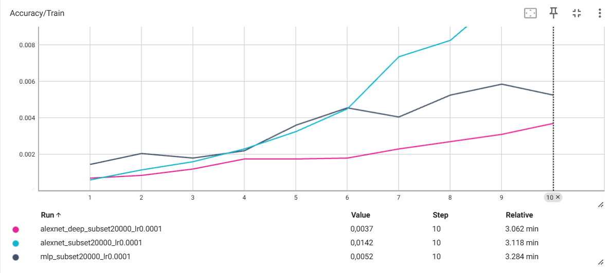
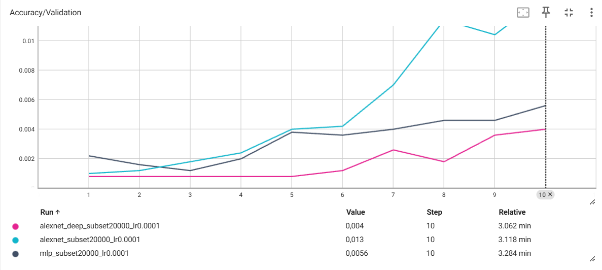
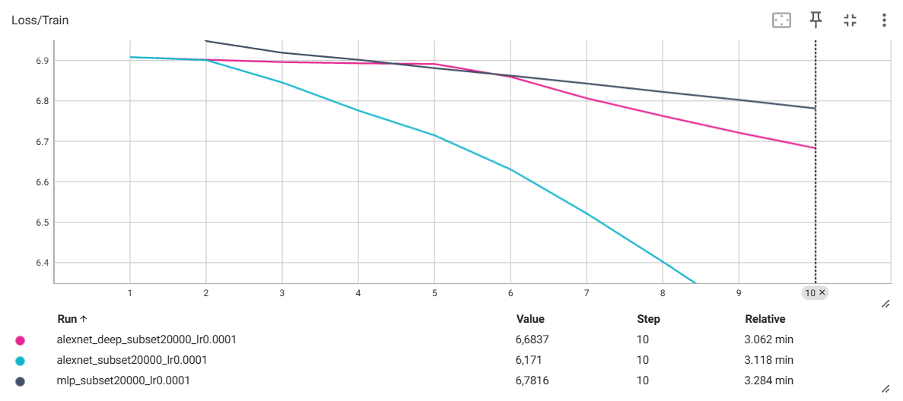
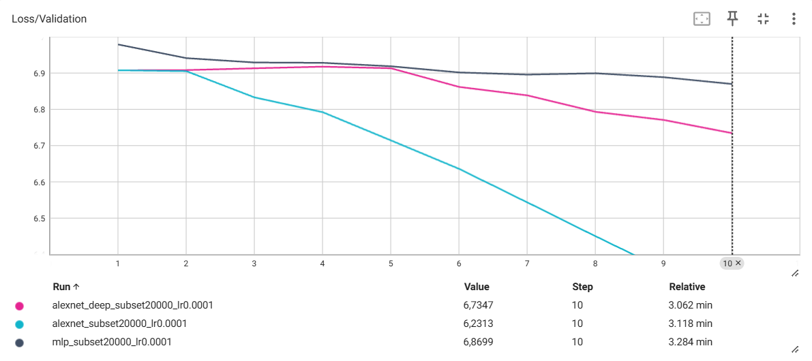

# TP3 — Réseaux convolutifs

Ce TP part du code fourni dans l’énoncé, avec plusieurs parties à compléter. Je me suis appuyé sur cette base pour préparer les données, lancer les entraînements sur le cluster et comparer les résultats. Les architectures MLP et AlexNet sont celles demandées ; pour la variante plus profonde, j’ai ajouté les trois convolutions prévues dans l’exercice.

## Exercice 1 — Préparation des données

Le jeu de données utilisé est ImageNet ILSVRC2012, avec 1 000 classes.

### Prétraitement

**Entraînement :**

- `RandomResizedCrop(227)` : recadrage aléatoire et redimensionnement.
- `RandomHorizontalFlip()` : retournement horizontal aléatoire.
- `ToTensor()` : conversion en tenseur.
- `Normalize()` : normalisation des canaux RGB.

**Validation :**

- `Resize(256)` puis `CenterCrop(227)` : préparation déterministe des images.
- `ToTensor()` et `Normalize()` : conversion et normalisation identiques à l'entraînement.

Les statistiques de normalisation sont :

- Moyenne : `[0.485, 0.456, 0.406]`
- Écart-type : `[0.229, 0.224, 0.225]`

Le prétraitement reprend les transformations indiquées dans l’énoncé et les valeurs de normalisation habituellement utilisées pour ImageNet. Elles sont identiques pour l'entraînement et la validation ; je ne les ai pas recalculées sur le sous-ensemble.

Pour l'entraînement, une même image peut donc être vue sous plusieurs cadrages et orientations. En validation, je garde un recadrage fixe pour comparer les époques dans les mêmes conditions.

Le retournement n'est pas toujours neutre : sur une image où la direction compte (par exemple une flèche), il peut changer le sens de l'objet. C'est une limite de cette augmentation.

## Exercice 2 — Architectures MLP et AlexNet

### Nombre de paramètres

| Modèle | Paramètres entraînables |
| --- | ---: |
| MLP | 39 897 320 |
| AlexNet | 61 100 840 |

J’ai vérifié ces nombres de paramètres avec PyTorch, à partir des architectures proposées dans l’énoncé.

Le MLP possède deux couches cachées de 256 neurones avec activation ReLU. Son entrée est une image RGB de dimensions 227 × 227, aplatie en un vecteur de 154 587 valeurs.

AlexNet utilise cinq couches convolutives, trois opérations de max-pooling et un classifieur entièrement connecté avec Dropout.

### Analyse

La première couche du MLP concentre la majorité de ses paramètres, car chaque neurone est connecté à tous les pixels d'entrée.

Contrairement au MLP, les convolutions d'AlexNet exploitent les relations spatiales locales et partagent leurs poids entre différentes positions de l'image.

### Dimensions et paramètres par couche

Les dimensions ont été vérifiées avec PyTorch pour une image RGB de taille 227 × 227. Les nombres de paramètres incluent les biais.

#### MLP

| Couche | Dimensions de sortie | Paramètres | Activations (KiB) |
| --- | ---: | ---: | ---: |
| Entrée aplatie | 154 587 | 0 | 603,9 |
| Linear 1 | 256 | 39 574 528 | 1,0 |
| ReLU | 256 | 0 | 1,0 |
| Linear 2 | 256 | 65 792 | 1,0 |
| ReLU | 256 | 0 | 1,0 |
| Linear 3 | 1 000 | 257 000 | 3,9 |
| **Total** | | **39 897 320** | |

La première couche représente à elle seule environ 99,2 % des paramètres du MLP : connecter tous les pixels aux 256 neurones coûte cher, même avec seulement deux couches cachées.

#### AlexNet

| Couche | Dimensions de sortie | Paramètres | Activations (KiB) |
| --- | --- | ---: | ---: |
| Entrée | 3 × 227 × 227 | 0 | 603,9 |
| Conv1 + ReLU | 64 × 56 × 56 | 23 296 | 784,0 |
| MaxPool1 | 64 × 27 × 27 | 0 | 182,2 |
| Conv2 + ReLU | 192 × 27 × 27 | 307 392 | 546,8 |
| MaxPool2 | 192 × 13 × 13 | 0 | 126,8 |
| Conv3 + ReLU | 384 × 13 × 13 | 663 936 | 253,5 |
| Conv4 + ReLU | 256 × 13 × 13 | 884 992 | 169,0 |
| Conv5 + ReLU | 256 × 13 × 13 | 590 080 | 169,0 |
| MaxPool3 | 256 × 6 × 6 | 0 | 36,0 |
| Flatten + Dropout | 9 216 | 0 | 36,0 |
| Linear1 + ReLU + Dropout | 4 096 | 37 752 832 | 16,0 |
| Linear2 + ReLU | 4 096 | 16 781 312 | 16,0 |
| Linear3 | 1 000 | 4 097 000 | 3,9 |
| **Total** | | **61 100 840** | |

Les valeurs de mémoire correspondent à la taille d'un tenseur d'activations pour une seule image, en précision float32 (4 octets par valeur). Elles ne représentent pas la consommation totale de mémoire pendant l'entraînement.

### Comparaison des architectures

Le MLP perd l'organisation spatiale de l'image dès l'aplatissement. AlexNet, lui, extrait d'abord des motifs locaux avec les convolutions, puis réduit progressivement la résolution avec le pooling.

Cela ne signifie pas qu'AlexNet a moins de paramètres : il en a même davantage dans notre implémentation. Son classifieur dense reste très lourd, notamment `Linear1`, qui représente environ 61,8 % du total.

Pour la mémoire des activations, la sortie de `Conv1` est la plus volumineuse dans le tableau (784 KiB pour une image). Ce chiffre ne correspond pas à la VRAM réellement occupée à l'entraînement : il faut aussi compter le batch, les tenseurs conservés pour le backward, les gradients et l'optimiseur.

## Exercice 3 — Entraînement et évaluation

### Configuration expérimentale

Pour les essais, j’ai conservé le principe de la boucle d’entraînement fournie dans l’énoncé, avec `CrossEntropyLoss`, Adam (`lr=1e-4`), un `weight_decay=1e-5` et un early stopping basé sur la perte de validation (`patience=5`). Les quatre métriques (loss et accuracy, train et validation) sont enregistrées dans TensorBoard. Le checkpoint conservé correspond à la meilleure perte de validation, pas forcément à la dernière époque.

**Mode entraînement et évaluation.** `model.train()` active notamment le Dropout d'AlexNet : une partie des activations est mise à zéro aléatoirement pendant l'apprentissage. `model.eval()` le désactive pour l'évaluation. Si on oublie `eval()`, la prédiction en validation dépend encore du masque aléatoire du Dropout : les métriques deviennent moins stables et ne reflètent pas correctement le comportement du modèle en inférence.

**Référence aléatoire.** Pour 1 000 classes équilibrées, une prédiction uniforme donne en moyenne `1/1000 = 0,1 %` d'accuracy et une cross-entropy de `ln(1000) ≈ 6,9078`. Ce sont des repères pour lire les premières époques, pas des performances à atteindre.

### Expérience 1 — MLP sur un sous-ensemble d'ImageNet

| Paramètre | Valeur |
| --- | --- |
| Modèle | MLP |
| Images d'entraînement | 20 000 |
| Images de validation | 5 000 |
| Époques | 10 |
| Batch size | 128 |
| Learning rate | 0,0001 |
| Optimiseur | Adam |
| Weight decay | 0,00001 |
| Patience | 5 |

#### Résultats

| Métrique | Époque 1 | Époque 10 |
| --- | ---: | ---: |
| Training loss | 7,1745 | 6,7816 |
| Training accuracy | 0,14 % | 0,53 % |
| Validation loss | 6,9788 | 6,8699 |
| Validation accuracy | 0,22 % | 0,56 % |

La loss d'entraînement descend de 7,1745 à 6,7816, mais la validation ne gagne que peu de terrain (6,9788 à 6,8699). À la dixième époque, l'accuracy de validation est de 0,56 % : c'est mieux que les 0,1 % du hasard, mais cela reste très faible.

La loss initiale du MLP (7,1745) est même au-dessus de `ln(1000)`. Ce n'est pas contradictoire avec le repère théorique : les sorties du réseau à l'initialisation ne sont pas nécessairement uniformes, et la métrique est calculée pendant une époque où les poids évoluent déjà. Le MLP semble apprendre quelque chose, sans parvenir à bien généraliser sur ce sous-ensemble.

Le meilleur modèle est enregistré dans `best_mlp_subset20000_lr0.0001.pth`.

### Expérience 2 — AlexNet

AlexNet a été entraîné dans les mêmes conditions que le MLP : 20 000 images d'entraînement, 5 000 images de validation, 10 époques, batch size de 128, learning rate de 0,0001 et optimiseur Adam.

#### Résultats

| Métrique | Époque 1 | Époque 5 | Époque 10 |
| --- | ---: | ---: | ---: |
| Training loss | 6,9083 | 6,7151 | 6,1710 |
| Training accuracy | 0,06 % | 0,33 % | 1,42 % |
| Validation loss | 6,9078 | 6,7147 | 6,2313 |
| Validation accuracy | 0,10 % | 0,40 % | 1,30 % |

Le meilleur modèle est enregistré dans `best_alexnet_subset20000_lr0.0001.pth`.

### Comparaison MLP / AlexNet

AlexNet démarre presque exactement au niveau du hasard : à l'époque 1, sa loss de validation vaut 6,9078 et son accuracy 0,10 %. Le MLP commence avec une loss plus élevée.

Après 10 époques, AlexNet atteint 1,30 % d'accuracy en validation contre 0,56 % pour le MLP. Sa loss de validation est également plus basse (6,2313 contre 6,8699). Sur cette expérience, AlexNet apprend donc nettement mieux.

**Et le surapprentissage ?** À l'époque 10, l'écart train/validation d'AlexNet reste modeste : 1,42 % contre 1,30 % d'accuracy, et 6,1710 contre 6,2313 de loss. Pour le MLP, les deux accuracies sont également proches (0,53 % et 0,56 %). On ne voit pas encore de surapprentissage marqué dans ces dix époques ; je ne peux donc pas affirmer qu'un des deux modèles surapprend « plus vite ». Avec seulement 20 000 images pour 1 000 classes, le risque existe, mais il faudrait prolonger l'entraînement pour le mesurer.

Enfin, la loss de validation d'AlexNet diminue encore à la dernière époque. Dix époques ne suffisent pas pour juger de sa convergence.

### Expérience : AlexNet avec trois couches convolutives supplémentaires

Une variante d'AlexNet, nommée `AlexNetDeep`, a été construite en ajoutant trois couches convolutives de 256 filtres (3×3, padding 1), chacune suivie d'une activation ReLU. Le réseau comporte ainsi huit couches convolutives au lieu de cinq.

Le nombre de paramètres passe de 61 100 840 à 62 871 080.

L'entraînement a été réalisé sur 20 000 images d'ImageNet, avec 5 000 images de validation, pendant 10 époques, en utilisant Adam (taux d'apprentissage de 0,0001) et des lots de 128 images.

| Modèle | Accuracy entraînement | Accuracy validation | Loss validation |
| --- | ---: | ---: | ---: |
| MLP | 0,53 % | 0,56 % | 6,8699 |
| AlexNet | 1,42 % | 1,30 % | 6,2313 |
| AlexNetDeep | 0,37 % | 0,40 % | 6,7347 |

AlexNetDeep démarre lentement : sa précision de validation reste à 0,08 % pendant les premières époques, puis atteint 0,40 % à l'époque 10. La loss de validation baisse de 6,9077 à 6,7347. Sur le même nombre d'époques, AlexNet standard arrive à 1,30 %.

**Sous-apprentissage ou surapprentissage ?** Ici, c'est plutôt une difficulté d'optimisation / un sous-apprentissage au début : les performances d'entraînement sont elles aussi faibles (0,37 % à l'époque 10). Ce n'est pas le scénario classique d'un modèle qui mémorise le train mais échoue sur la validation.

En ajoutant trois convolutions successives sans connexion résiduelle, on allonge le chemin que le gradient doit parcourir lors de la rétropropagation. Le produit des dérivées à travers davantage de couches peut rendre les mises à jour des premières couches moins efficaces, notamment si certains gradients s'atténuent. C'est une explication plausible de ce démarrage lent, pas une preuve : nous n'avons pas mesuré les normes des gradients. Un autre réglage de l'optimisation ou davantage d'époques pourrait changer le résultat.

### Courbes TensorBoard — Comparaison des architectures

Les courbes suivantes comparent le MLP, AlexNet et AlexNetDeep sur un sous-ensemble identique de 20 000 images d'entraînement et 5 000 images de validation, pendant 10 époques.

**Accuracy — Entraînement**

**Accuracy — Validation**

**Loss — Entraînement**

**Loss — Validation**

Les courbes confirment les valeurs des tableaux : AlexNet progresse plus franchement, tandis qu'AlexNetDeep reste presque au niveau du hasard au début. Je ne vois pas de divergence nette entre entraînement et validation sur ces dix époques ; le problème principal est plutôt que les modèles n'ont pas encore beaucoup appris.

## Exercice 4 — Entraînement sur ImageNet complet

### Configuration expérimentale

L'entraînement d'AlexNet a été lancé sur l'ensemble complet d'ImageNet ILSVRC2012, comprenant 1 281 167 images d'entraînement et 50 000 images de validation, réparties en 1 000 classes.

Le modèle comporte 61 100 840 paramètres. L'expérience utilise Adam avec un taux d'apprentissage de 0,0001, des lots de 128 images et un maximum de 50 époques. Le calcul est exécuté sur un GPU NVIDIA L4 au moyen de Slurm (job 14459).

### Premiers résultats

À la fin de la première époque, les résultats obtenus sont les suivants :

| Métrique | Entraînement | Validation |
| --- | ---: | ---: |
| Loss | 5,6029 | 4,6406 |
| Accuracy | 5,05 % | 12,32 % |

Ces premiers résultats montrent que le modèle commence à apprendre sur l'ensemble complet. La validation est déjà meilleure que l'entraînement après une époque. Deux différences du code peuvent l'expliquer : le Dropout est actif en `train()` mais désactivé en `eval()`, et les images d'entraînement subissent des recadrages et retournements aléatoires, alors que les images de validation sont préparées de façon fixe. En plus, l'accuracy d'entraînement est moyennée sur une époque pendant laquelle le modèle apprend, tandis que la validation est mesurée avec les poids obtenus en fin d'époque.

Ces observations restent préliminaires : une seule époque ne permet pas encore de caractériser la convergence ni de conclure à un éventuel surapprentissage.

### Durée d'entraînement et estimation pour 100 époques

J'ai relevé les heures d'enregistrement des métriques TensorBoard pour trois époques successives :

| Époque | Heure de fin | Durée depuis l'époque précédente |
| --- | --- | --- |
| 1 | 12:00:36 | — |
| 2 | 12:24:14 | 23 min 38 s |
| 3 | 12:48:03 | 23 min 49 s |

La durée moyenne mesurée est donc de **23 min 43,5 s par époque**.

En supposant cette durée constante et sans early stopping, j'estime :

- **50 époques : environ 19 h 46 min** ;
- **100 époques : environ 39 h 34 min**.

Il s'agit d'une extrapolation, pas d'une durée réellement mesurée sur 100 époques. Le job Slurm étant limité à quatre heures, il ne pourra pas terminer les 50 époques prévues dans cette seule exécution.

### Évolution sur plusieurs époques et comparaison avec le sous-ensemble

Voici les résultats des trois premières époques sur ImageNet complet :

| Époque | Train loss | Train accuracy | Val loss | Val accuracy |
| --- | --- | --- | --- | --- |
| 1 | 5,6029 | 5,05 % | 4,6406 | 12,32 % |
| 2 | 4,6223 | 13,29 % | 3,9515 | 20,54 % |
| 3 | 4,2044 | 18,47 % | 3,5999 | 25,74 % |

Les quatre métriques évoluent dans le bon sens : les losses diminuent et les accuracies augmentent, aussi bien en entraînement qu'en validation.

La différence avec l'expérience sur 20 000 images est importante. Sur le sous-ensemble, AlexNet atteignait seulement 1,30 % d'accuracy en validation après dix époques. Sur ImageNet complet, il atteint déjà 25,74 % après trois époques.

Il faut toutefois garder en tête qu'une époque complète représente beaucoup plus d'images et de mises à jour qu'une époque sur le sous-ensemble. On ne peut donc pas attribuer cette différence uniquement à la taille des données.

Pour le surapprentissage, je ne constate pas encore de dégradation de la validation : sa loss continue de baisser sur les trois premières époques. Sur le sous-ensemble, les résultats restaient également faibles et sans divergence nette entre entraînement et validation. Ces observations ne suffisent pas pour conclure définitivement que l'entraînement complet surapprend moins, mais elles montrent une progression beaucoup plus nette.

La loss de validation reste inférieure à celle de l'entraînement sur les trois époques. Cela peut notamment s'expliquer par le Dropout et les augmentations de données actifs pendant l'entraînement, ainsi que par le fait que les métriques d'entraînement sont moyennées pendant que les poids évoluent.
