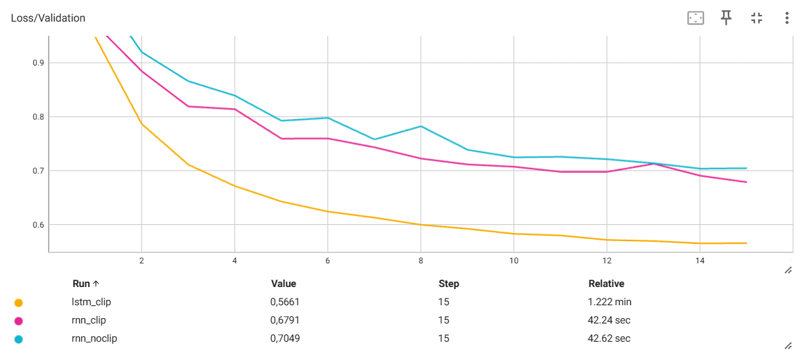
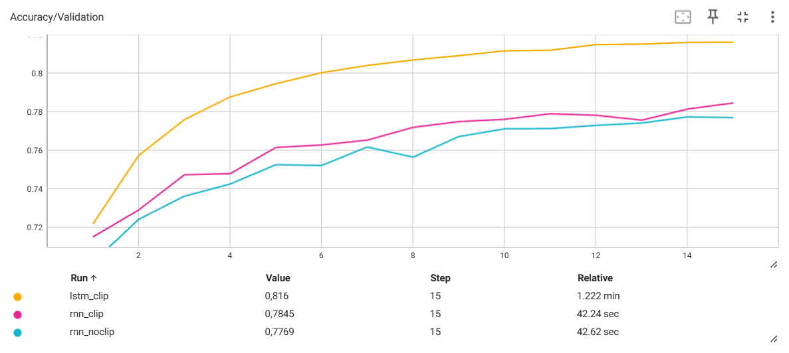
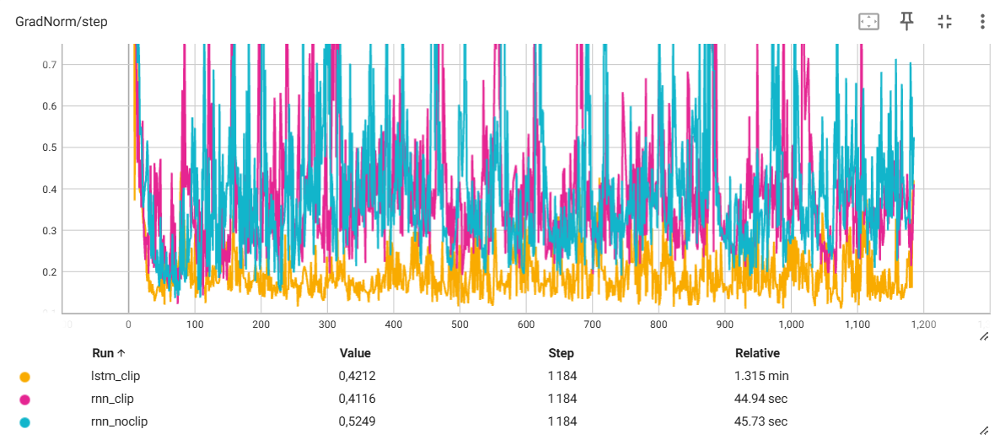

# TP4 — Réseaux récurrents et génération de séquences

## Exercice 1 — Exploration et prétraitement des partitions ABC

### Étape 1 — Chargement et découverte du jeu de données

Les fichiers JSON ont été chargés avec `json.load()`. Chaque entrée contient une partition musicale sous forme de texte, accessible par la clé `"abc notation"`.

Le jeu de données comprend :
- **214 122 partitions** pour l'entraînement ;
- **2 162 partitions** pour la validation.

La première partition du jeu d'entraînement est :

```text
X:1
L:1/8
M:4/4
K:Emin
|: E2 EF E2 EF | DEFG AFDF | E2 EF E2 B2 |1 efe^d e2 e2 :|2 efe^d e3 B |: e2 ef g2 fe |
 defg afdf |1 e2 ef g2 fe | efe^d e3 B :|2 g2 bg f2 af | efe^d e2 e2 ||
```

**Interprétation des métadonnées :**

- `X:1` : identifiant de la partition.
- `L:1/8` : durée de référence des notes, correspondant à une croche.
- `M:4/4` : signature rythmique indiquant quatre temps par mesure.
- `K:Emin` : tonalité de mi mineur.

Dans le corps de la partition, les lettres représentent les notes, les nombres modifient leur durée et les symboles indiquent notamment les mesures, les reprises et les altérations.

### Étape 2 — Construction du vocabulaire et padding

**1. Statistiques du jeu de données**

L'analyse des partitions donne les résultats suivants :

- Taille du vocabulaire : **95 caractères uniques**.
- Longueur moyenne : **290,1 caractères**.
- Longueur maximale : **2 968 caractères**.

Les partitions sont normalisées à une longueur fixe de 500 caractères par troncature ou ajout d'espaces.

**2. Pourquoi utiliser `sorted()` sur les caractères uniques ?**

Un `set` ne garantit pas un ordre stable entre les exécutions. L'utilisation de `sorted()` permet donc de construire un dictionnaire `char_to_index` déterministe.

Sans ce tri, les indices associés aux caractères pourraient changer entre deux exécutions. Lors du rechargement d'un modèle sauvegardé, les indices risqueraient alors de ne plus correspondre aux mêmes caractères, ce qui rendrait les embeddings et les prédictions incorrects.

**3. Pourquoi choisir `SEQ_LENGTH = 500` plutôt que `max_len = 2968` ?**

La longueur moyenne des partitions est de 290,1 caractères. Une longueur de 500 permet donc de conserver intégralement de nombreuses partitions tout en limitant le padding et le coût de calcul.

Un padding jusqu'à 2 968 caractères produirait des séquences presque six fois plus longues, augmentant fortement le temps d'entraînement et la mémoire GPU nécessaire, notamment pour la rétropropagation à travers le temps (BPTT).

De plus, une grande partie des positions correspondrait à des espaces ajoutés artificiellement. Le modèle risquerait alors d'apprendre principalement à prédire ces espaces plutôt que les structures musicales.

Le choix de 500 caractères constitue donc un compromis entre conservation de l'information et efficacité de calcul.

## Exercice 2 — Dataset PyTorch auto-régressif et modélisation

### Étape 1 — Création du MusicDataset

Le `MusicDataset` transforme les partitions ABC en séquences d'indices numériques et prépare les données pour un apprentissage auto-régressif.

Pour chaque séquence de 500 caractères, l'entrée `x` contient les 499 premiers caractères (`seq[:-1]`), tandis que la cible `y` contient les 499 derniers (`seq[1:]`). Le modèle apprend ainsi à prédire le caractère suivant à chaque pas de temps.

Avec `SEQ_LENGTH = 500` et `BATCH_SIZE = 128`, les dimensions obtenues sont :

- **x :** `torch.Size([128, 499])`
- **y :** `torch.Size([128, 499])`

Le type `torch.long` (`int64`) est nécessaire car les caractères sont représentés par des indices entiers utilisés par la couche `nn.Embedding`. Le type `torch.float32` ne convient pas pour indexer directement cette couche.

Les tests réalisés sur un sous-ensemble de 10 000 partitions confirment les dimensions attendues et le décalage temporel entre les entrées et les cibles.

### Étape 2 — Architecture récurrente : RNN vs LSTM

**1. Calcul théorique du nombre de paramètres**

On considère un vocabulaire de taille \(V=95\), une dimension d'embedding \(E=256\) et une dimension cachée \(H=512\).

**Couche Embedding (identique pour les deux architectures)**

\[
P_{\text{embedding}} = V \times E = 95 \times 256 = 24\,320
\]

**RNN classique (Elman)**

La couche `nn.RNN` possède une matrice entrée-état, une matrice état-état et deux vecteurs de biais :

\[
P_{\text{RNN}} = HE + H^2 + 2H
\]

\[
= 512 \times 256 + 512^2 + 2 \times 512 = 394\,240
\]

**LSTM**

Le LSTM possède quatre ensembles de paramètres correspondant à la porte d'entrée, la porte d'oubli, la porte de sortie et la mise à jour candidate de la mémoire :

\[
P_{\text{LSTM}} = 4(HE + H^2 + 2H)
\]

\[
= 4 \times 394\,240 = 1\,576\,960
\]

Le bloc LSTM possède donc quatre fois plus de paramètres que le bloc RNN classique, chaque porte disposant de ses propres poids et biais.

**Couche linéaire de sortie**

\[
P_{\text{Linear}} = HV + V = 512 \times 95 + 95 = 48\,735
\]

**Nombre total de paramètres :**

| Couche | RNN | LSTM |
|---|---:|---:|
| Embedding | 24 320 | 24 320 |
| Récurrente | 394 240 | 1 576 960 |
| Linear | 48 735 | 48 735 |
| **Total** | **467 295** | **1 650 015** |

Les valeurs calculées ont été vérifiées avec `count_parameters()` et correspondent aux résultats obtenus avec PyTorch.

**2. Pourquoi utiliser `nn.Embedding` plutôt qu'une projection linéaire d'un indice scalaire ?**

Les indices des caractères sont des identifiants arbitraires et non des valeurs numériques représentant une grandeur.

Une transformation linéaire appliquée directement à un indice scalaire imposerait une relation artificielle entre les caractères : deux indices proches seraient traités comme des valeurs proches et leurs représentations seraient contraintes à une même direction affine.

Au contraire, `nn.Embedding` apprend un vecteur indépendant pour chaque caractère. Cela permet au modèle de construire des représentations adaptées aux relations statistiques entre les caractères.

**3. Différence entre les états cachés RNN et LSTM**

Pour un RNN classique, `hidden_state` est un unique tenseur représentant l'état caché final :

`(num_layers, batch_size, hidden_size)`

Dans notre test : `(1, 2, 512)`.

Pour un LSTM, `hidden_state` est un tuple `(h_n, c_n)` contenant deux tenseurs :

- `h_n` : état caché utilisé pour produire les sorties et transmettre l'information au pas suivant.
- `c_n` : état de cellule représentant la mémoire interne, qui permet de conserver des informations sur des dépendances temporelles plus longues.

Les deux tenseurs ont ici la forme `(1, 2, 512)`.

Les tests confirment également que les deux modèles produisent des logits de forme `(2, 20, 95)` pour une entrée de deux séquences de vingt caractères.

## Exercice 3 — Entraînement et comparaison des modèles

### Protocole expérimental

Nous avons entraîné trois modèles de prédiction du caractère suivant : un RNN sans gradient clipping, un RNN avec gradient clipping et un LSTM avec gradient clipping.

Les trois expériences utilisent :

- 10 000 partitions pour l'entraînement et 2 162 pour la validation ;
- une longueur de séquence de 500 caractères ;
- un batch size de 128 ;
- une dimension d'embedding de 256 et un état caché de 512 ;
- l'optimiseur Adam avec un learning rate de 0,001 ;
- 15 époques, avec une patience de 5 époques pour l'early stopping.

Le gradient clipping est réalisé avec `clip_grad_norm_` et une norme maximale de 1,0. Les entraînements ont été exécutés sur GPU via Slurm. Les métriques ont été enregistrées dans TensorBoard et le meilleur modèle de chaque expérience a été sauvegardé selon la perte de validation.

### Calcul de la loss et gradient clipping

**Pourquoi réorganiser les logits et les cibles ?**

Le modèle produit des logits de dimensions `(batch_size, seq_length - 1, vocab_size)`, soit `(128, 499, 95)` pour un batch complet.

La fonction `CrossEntropyLoss` attend les classes sur la deuxième dimension, ou bien un tableau de prédictions de forme `(N, C)`. Nous regroupons donc les dimensions batch et temps :

```python
loss = criterion(
    logits.reshape(-1, vocab_size),
    y.reshape(-1)
)
```

On obtient ainsi :

- Logits : `(63872, 95)`
- Cibles : `(63872,)`

Chaque caractère prédit est comparé à sa cible, indépendamment de sa position dans le batch.

**Pourquoi appliquer le clipping entre `backward()` et `step()` ?**

L'ordre utilisé est :

```python
optimizer.zero_grad()
loss.backward()

if max_norm is not None:
    torch.nn.utils.clip_grad_norm_(model.parameters(), max_norm)

optimizer.step()
```

`loss.backward()` calcule les gradients. Le clipping peut ensuite limiter leur norme avant que `optimizer.step()` ne mette à jour les paramètres.

L'appliquer avant `backward()` serait inutile, puisque les gradients de l'itération courante n'auraient pas encore été calculés. L'appliquer après `step()` serait trop tard pour modifier cette mise à jour.

### Résultats

| Modèle | Clipping | Meilleure perte de validation | Accuracy de validation au meilleur checkpoint | Époque optimale |
|---|---|---:|---:|---:|
| RNN | Non | 0,7041 | 77,73 % | 14 |
| RNN | Oui (1,0) | 0,6791 | 78,45 % | 15 |
| LSTM | Oui (1,0) | **0,5658** | **81,59 %** | 14 |

### Courbes TensorBoard

Les courbes suivantes comparent les trois expériences réalisées sur 15 époques.

**Perte de validation**



**Accuracy de validation**



**Norme des gradients par étape**



### Analyse des résultats

Les courbes montrent une diminution globale de la perte de validation et une augmentation de l'accuracy pour les trois modèles.

Le RNN avec clipping obtient une perte de validation légèrement inférieure à celle du RNN sans clipping : 0,6791 contre 0,7041. Son accuracy est également un peu meilleure, avec 78,45 % contre 77,73 %.

Sur les courbes de normes des gradients, les deux RNN présentent des fluctuations importantes et plusieurs pics. Cependant, nous n'observons pas d'explosion manifeste des gradients dans le RNN sans clipping. Les normes restent généralement modérées, ce qui ne permet pas d'attribuer avec certitude l'amélioration au clipping.

De plus, `clip_grad_norm_` retourne la norme calculée avant sa limitation. Si cette valeur est enregistrée dans TensorBoard, des pics supérieurs au seuil de clipping peuvent donc apparaître même lorsque le clipping est activé.

Le LSTM obtient les meilleurs résultats, avec une perte de validation de 0,5658 contre 0,6791 pour le RNN avec clipping. Il atteint également une accuracy de 81,59 %. Ses normes de gradients sont généralement plus faibles dans les expériences observées.

### Pourquoi le LSTM peut-il mieux conserver l'information ?

Contrairement au RNN classique, le LSTM possède un état de cellule \(c_t\) mis à jour à l'aide de plusieurs portes :

\[
f_t = \sigma(W_f x_t + U_f h_{t-1} + b_f)
\]

\[
i_t = \sigma(W_i x_t + U_i h_{t-1} + b_i)
\]

\[
\widetilde{c}_t = \tanh(W_c x_t + U_c h_{t-1} + b_c)
\]

\[
c_t = f_t \odot c_{t-1} + i_t \odot \widetilde{c}_t
\]

\[
o_t = \sigma(W_o x_t + U_o h_{t-1} + b_o)
\]

\[
h_t = o_t \odot \tanh(c_t)
\]

La porte d'oubli \(f_t\) contrôle la partie de la mémoire précédente à conserver, tandis que la porte d'entrée \(i_t\) contrôle l'ajout de nouvelles informations.

Cette mise à jour additive de l'état de cellule facilite la circulation de l'information et des gradients sur plusieurs pas de temps. Elle aide le LSTM à apprendre des dépendances plus longues, par exemple les répétitions de motifs et les structures rythmiques dans une partition ABC.

### Effet du padding sur l'accuracy

Les séquences plus courtes que 500 caractères sont complétées par des espaces. Ces espaces sont également présents dans les cibles utilisées pendant l'entraînement.

Le modèle peut donc obtenir une bonne accuracy en prédisant correctement les positions de padding, sans nécessairement mieux prédire les caractères musicaux.

Pour exclure ces positions de la fonction de perte, on peut utiliser :

```python
criterion = nn.CrossEntropyLoss(
    ignore_index=char_to_index[" "]
)
```

Il faudrait également adapter le calcul de l'accuracy pour ignorer les positions correspondantes.

Cette solution présente toutefois une limite : le caractère espace existe aussi naturellement dans les partitions ABC. Avec `ignore_index`, les vrais espaces seraient également ignorés. Une solution plus précise consisterait à utiliser un token de padding distinct ou un masque permettant de différencier les espaces réels du remplissage.

Les accuracy présentées dans le tableau correspondent aux mesures obtenues pendant nos expériences, sans cette correction. Elles doivent donc être interprétées avec prudence.

### Conclusion

Sur les configurations testées, le LSTM avec gradient clipping obtient les meilleurs résultats de validation. Nous retenons donc cette architecture pour la génération de nouvelles partitions musicales.

## Exercice 4 — Génération de musique

### Génération autorégressive

La génération est réalisée caractère par caractère à partir du prompt suivant :

```text
X:1
T:Irish Reel
M:4/4
L:1/8
K:D
```

Le modèle reçoit d'abord le prompt complet, puis prédit la distribution du caractère suivant. Un caractère est échantillonné et réinjecté dans le réseau pour produire le suivant.

L'état caché est conservé entre les étapes. Pour le LSTM, cela correspond au tuple `(h, c)`, qui contient l'état caché et l'état de cellule.

**Pourquoi conserver l'état caché ?**

En conservant l'état caché, nous n'avons pas besoin de recalculer toutes les positions précédentes à chaque nouveau caractère.

Pour \(N\) caractères générés, le coût de génération après traitement du prompt est proportionnel à \(O(N)\), à architecture et dimensions fixes.

Si nous réexécutions le modèle sur toute la séquence depuis le début à chaque étape, nous traiterions successivement des séquences de longueur 1, 2, 3, ..., \(N\), ce qui donnerait un coût total en \(O(N^2)\).

### Influence de la température

La température \(T\) modifie les probabilités obtenues après la fonction softmax :

\[
P(i) = \frac{\exp(z_i/T)}{\sum_j \exp(z_j/T)}
\]

où \(z_i\) est le logit associé au caractère \(i\).

- Lorsque \(T \rightarrow 0^+\), la distribution se concentre sur les caractères les plus probables. La génération tend vers une sélection de type `argmax`.
- Lorsque \(T \rightarrow +\infty\), les probabilités tendent vers une distribution uniforme sur les caractères du vocabulaire.

Une faible température rend la génération plus prévisible, tandis qu'une température élevée favorise la diversité, au risque de perdre la structure musicale.

### Entraînement d'un LSTM étendu

Après les trois expériences initiales, nous avons entraîné un LSTM plus grand afin d'améliorer la génération.

La configuration retenue est :

| Paramètre | Valeur |
|---|---|
| Architecture | LSTM |
| Partitions d'entraînement | 50 000 |
| Partitions de validation | 2 162 |
| Dimension d'embedding | 256 |
| Dimension cachée | 1 024 |
| Batch size | 128 |
| Longueur des séquences | 500 |
| Learning rate | 0,001 |
| Gradient clipping | 1,0 |
| Nombre maximal d'époques | 30 |
| Patience | 5 |

L'entraînement s'est arrêté automatiquement après **22 époques**, car la perte de validation ne s'améliorait plus suffisamment.

Le meilleur checkpoint a été obtenu à l'**époque 17** :

- Perte d'entraînement : **0,3903**
- Accuracy d'entraînement : **87,08 %**
- Perte de validation : **0,4537**
- Accuracy de validation : **85,42 %**

Ce modèle obtient une meilleure perte de validation que le LSTM initial (0,5658). Il faut cependant tenir compte du fait que nous avons également augmenté la taille de l'état caché et le nombre de partitions d'entraînement. Nous ne pouvons donc pas attribuer cette amélioration à un seul de ces changements.

### Génération des trois partitions

Nous avons utilisé le meilleur checkpoint du LSTM étendu pour générer **300 caractères supplémentaires** à partir du même prompt, avec trois températures : 0,2, 0,8 et 2,0.

Les trois générations ont été testées dans ABC Player. Elles sont toutes acceptées par le lecteur et peuvent être jouées, même si leur structure musicale est très différente.

**Température T = 0,2**

Fichier : `outputs/music_long_temp_02.abc`

```text
X:1
T:Irish Reel
M:4/4
L:1/8
K:D
"^Mass written" d/e/ | f>ed dAA | B>AB dAA | d>ed dAF | A>BA A2 :: d | d>ed dAF | ABA A2 d |
 d>ed dAF | ABA A2 d/e/ | f>gf ede | fdB BAF | ABA AFA | d>ed d2 :|                                                     
```

Cette génération contient plusieurs motifs répétés, notamment `d>ed dAF` et `ABA A2 d`. La faible température favorise les caractères les plus probables, ce qui limite la diversité. Une partie importante de la fin est constituée d'espaces, ce qui réduit la quantité de contenu musical effectivement généré.

**Température T = 0,8**

Fichier : `outputs/music_long_temp_08.abc`

```text
X:1
T:Irish Reel
M:4/4
L:1/8
K:D
"^MO.NB" z/ | FEF D2 d | cAG FEF | GFG AAF | GFG E2 G | FEF dAG | FEF D2 d | cAG GFE | FDD D3 |]
 FED FGA | (3fdA F GBA | GFG EFG | AGF EDD | FGA Bcd | efd cBA | (3Bcd B cAF | GAG F2 D ||"^maroar : 3 12" FGA AGF |
 GFG ECD | FAA GFG | ABG FED | FED FGA | BcA GFE | FGA Bcd | cAF GFE |]
```

Cette génération présente davantage de variations mélodiques et rythmiques, tout en conservant des motifs reconnaissables et une organisation en mesures.

Cependant, plusieurs marqueurs de fin (`|]` et `||`) apparaissent au milieu de la séquence. Le modèle continue donc à générer du texte après une première fin de partition. Le résultat est jouable, mais sa structure globale n'est pas entièrement cohérente.

**Température T = 2,0**

Fichier : `outputs/music_long_temp_20.abc`

```text
X:1
T:Irish Reel
M:4/4
L:1/8
K:D
"^MO.NBUn.ro5f" [fd]^f=ggGgf | e2 e- e4 |: c"_/B"Ba-a>g eB g2 |\ z z7/4z4{B}B{cc}[BB,gB]\F"G"Gade{eF}c |
[M:6/8]{Td}4 cf-Me{Ad}A3- |SMM[MIM4MDMi 7" a2<c z2 a2 a/6g<Ae/ | agSegd>ed F | c3 a2-a>A |S a3 z2 a>ce |
[M:3/4] .f3g .a AA] |[M:3/81227K:A3/28 [CDF]8-) | Ma{Bac[acB7ac^[ca]{falsgatdd}[eA]=g2Pf
```

Cette génération contient une grande diversité de caractères, mais également des fragments de notation inhabituels, des annotations peu cohérentes et plusieurs changements de métrique.

Même si ABC Player accepte le texte, la structure de la partition est nettement moins régulière. La température élevée favorise des caractères peu probables et dégrade la cohérence de la génération.

### Comparaison des températures

| Température | Diversité | Structure observée | Lecture ABC |
|---|---|---|---|
| 0,2 | Faible | Motifs répétitifs, nombreux espaces en fin de séquence | Fonctionne |
| 0,8 | Modérée | Motifs variés et mesures reconnaissables, mais plusieurs fins de partition | Fonctionne |
| 2,0 | Élevée | Notation irrégulière et fragments incohérents | Fonctionne |

Parmi ces trois exemples, la température **0,8** présente le meilleur compromis entre diversité et structure musicale. La température 0,2 produit des séquences trop répétitives, tandis que 2,0 introduit trop d'irrégularités.

Ces observations restent qualitatives et reposent sur une seule génération par température. Le fait qu'une partition soit acceptée par ABC Player ne garantit pas que toutes ses mesures respectent parfaitement la métrique annoncée.

### Conclusion

Les expériences montrent que les LSTM obtiennent de meilleurs résultats de prédiction que les RNN classiques dans les configurations testées.

L'entraînement sur davantage de partitions, avec un état caché plus grand, a permis d'améliorer les métriques de validation et de produire des séquences ABC contenant des structures musicales reconnaissables.

La température joue un rôle important dans la qualité des générations. Une valeur intermédiaire comme 0,8 semble ici plus adaptée qu'une température très faible ou très élevée, même si les partitions générées présentent encore des limites de cohérence.
